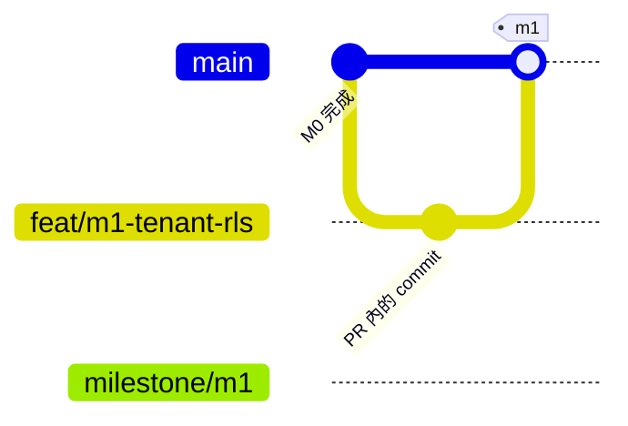

# ADR 0006：GitHub Flow、短生命週期分支與 squash merge

- 狀態：已接受（2026-11-24，經使用者確認；增補「里程碑保留分支」）
- 範圍：分支、PR、合併與發布

## 背景

目前只有一個正式線，沒有多版本維護、發布凍結或多環境部署的需求；開發者是一位使用者加 AI 協作，
AI 無法直接推送（只能交付 patch），且高風險變更不能只依賴 AI 自我審查。

## 選項

| 選項 | 適用情境 | 為什麼不選／選 |
|---|---|---|
| Git Flow（develop、release、hotfix） | 排程發布、需同時維護多條發布線 | 沒有這些需求，只會增加分支與合併成本 |
| GitLab Flow（環境分支） | 需要明確管理多個部署環境 | PoC 只在本機與 CI，沒有多環境 |
| 純 Trunk-Based（直接整合加 feature flag） | CI/CD 成熟、整合頻率高 | 目前更需要每個變更有人審查，且尚無 flag 機制 |
| **GitHub Flow** | 一條可發布的主線，短分支加 PR | 符合現況，也是規範的預設選擇 |

## 決定

1. **`main` 永遠可建置、可測試。** 所有變更都經過分支與 PR，不直接推送到 `main`。
2. **分支命名** `<type>/<milestone>-<描述>`，例如 `feat/m1-tenant-rls`；type 使用 `feat`、`fix`、`docs`、`test`、`refactor`、`build`、`ci`、`chore`。
3. **短生命週期、小 PR。** 一個 PR 只做一件可審查的事，以 1 到 2 天內合併為目標；重構與功能修改分開。
   資料庫 migration 依 expand-and-contract 拆成不同 PR，讓每個 PR 合併後 `main` 都能與舊版程式碼共存。
4. **合併方式：squash merge**，每個 PR 在 `main` 上是一個 Conventional Commits（中文）。PR 保留完整討論與細節。
5. **`main` 的分支保護（由使用者在 GitHub 設定）：**
   - 必須經過 PR；禁止 force push 與刪除。
   - 必要的狀態檢查：`quality`、`test`、`docker-build`，且分支必須與 `main` 同步。
   - 只允許 squash merge；合併後自動刪除分支。
6. **審查：** 使用者是審查者。涉及 migration、RLS、授權、去識別化、計費的 PR 必須由使用者明確審查，不得只靠 AI 自我審查。
7. **發布與里程碑：** 不使用 release 或 hotfix 分支。每個里程碑的最後一個 PR 合併後，在通過 CI 的 `main` 提交上做兩件事：
   - 打 tag：`m0`、`m1`…
   - **保留一支里程碑分支** `milestone/mN`，指向同一個提交，作為該里程碑結束時最新狀態的凍結快照。這支分支不再接收新的 commit，也不刪除。

   這是對「每個里程碑結束時請留一支最新的」的解讀；若使用者的本意不同（例如保留的是最後一個功能分支，或需要持續更新的分支），修改此條即可。
   `milestone/*` 建議加上分支保護：禁止刪除與 force push。建立方式（由使用者在 GitHub 操作，AI 會在每個里程碑結束時提醒並附上指令）：

   ```bash
   git switch main && git pull
   git tag -a m1 -m "M1 完成"
   git push origin m1
   git branch milestone/m1 m1
   git push origin milestone/m1
   ```
8. **PR 內容：** 使用 `.github/pull_request_template.md`：目的、主要變更、驗證（只寫實際執行過的指令與結果）、風險與相容性、待決事項。
9. **目前的交付流程：** AI 在沙箱建立分支並交付 patch（`git format-patch`），使用者在自己的分支上 `git am` 後推送、開 PR：

   ```bash
   git switch -c feat/m1-tenant-rls
   git am /路徑/檔名.mbox
   git push -u origin feat/m1-tenant-rls
   ```

   `git am` 會重新建立 commit，hash 與沙箱不同，這是正常的，不要依賴沙箱回報的 hash。
10. **跨 repo：** 若 Agent 另開 repo，套用同樣策略；兩邊共用的契約（推論契約、MCP 工具 schema）採「先相容地新增、再遷移、最後移除」，兩邊的 PR 互相連結。

## 分支關係



## 後果

- 流程輕量，每個變更都有 CI 與人工審查把關。
- squash 會讓分支內的中間 commit 不留在 `main`，需要時看 PR。
- 每個里程碑多一支永久分支，數量等於里程碑數，成本很低。
- 若團隊超過 3 人，或需要持續部署到多個環境，重新評估（例如導入 feature flag 與 trunk-based）。
