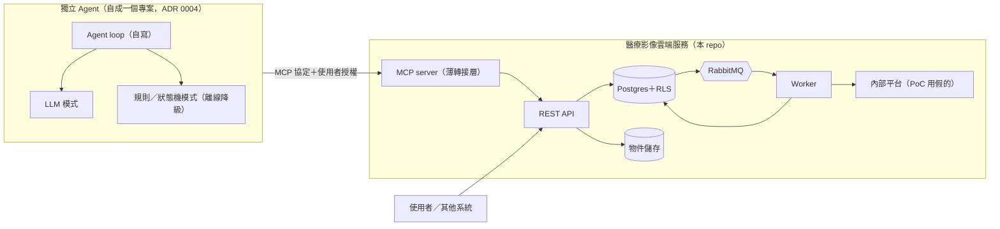
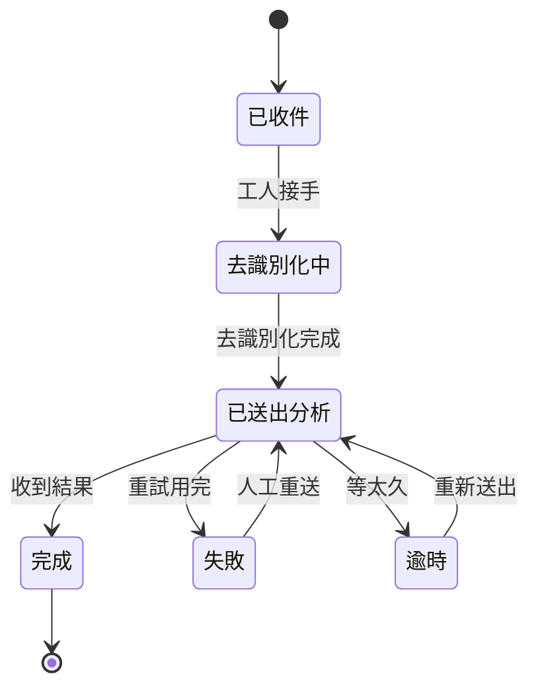
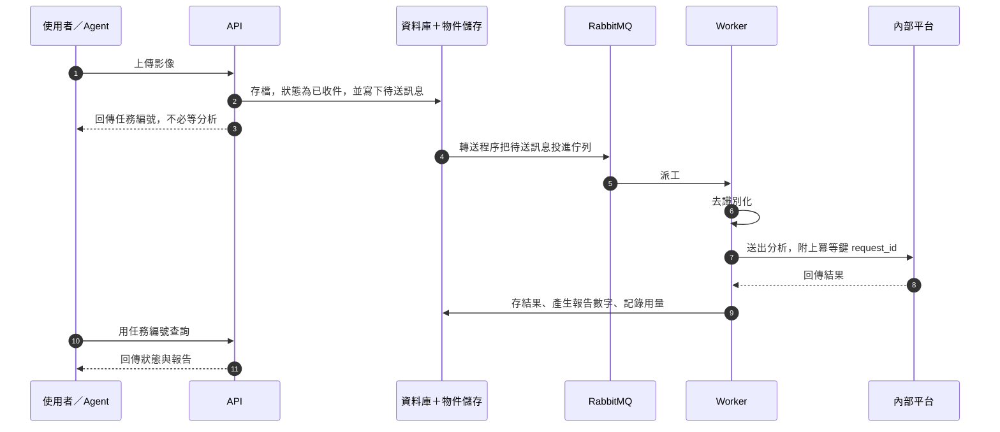
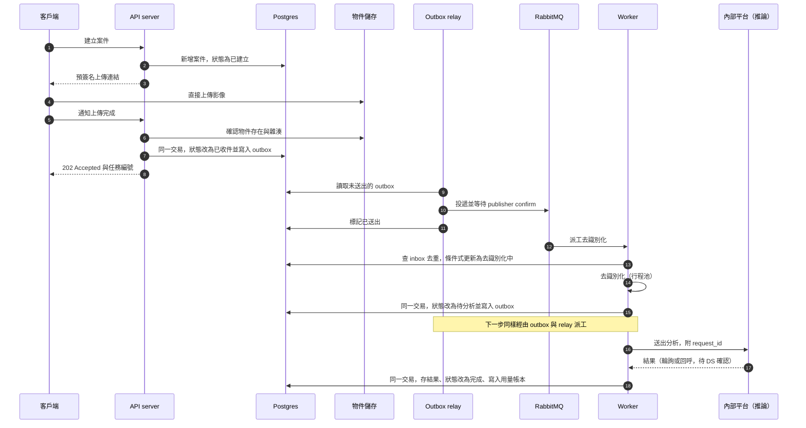
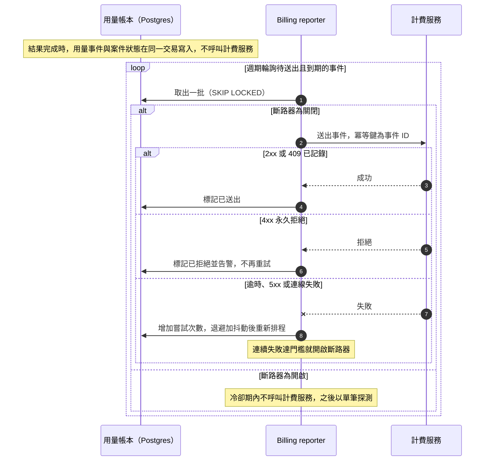

# 架構與流程

本文件描述 PoC 的目標架構。M0 只實作其中的骨架（見 README 的里程碑），其餘為設計。決策與取捨見 [docs/adr/](adr/)。

## 元件

- **事實來源是 Postgres**：案件狀態、待送訊息（outbox）、重試記帳、用量事件都在資料庫（ADR 0002）。
- **MCP server 沒有資料庫權限**，只呼叫公開的 REST API（ADR 0004）。
- 內部平台（身分、推論、計費）在 PoC 中由可注入故障的假服務取代，只存在於測試與開發環境。

## 案件狀態

狀態轉移以條件式 `UPDATE ... WHERE status = ...` 完成，避免更新被覆蓋；重複的轉移請求不會產生第二次副作用。

## 一張影像的流程

## 可靠性原則

- 訊息 at-least-once，消費端冪等；不宣稱 exactly-once。
- 對外部平台：逐層逾時（下游期限比上游短）、有限次數退避重試加抖動、斷路器、並發上限；收件不依賴平台。
- 非同步工作有逾時掃描器（`FOR UPDATE SKIP LOCKED`），重試用完進入 DLQ 並可重播。
- 租戶隔離：應用層授權為第一道，Postgres RLS（`FORCE ROW LEVEL SECURITY`、非 owner 角色）為最後防線。

## 進程與職責

同一個 codebase，以不同入口啟動多個進程（ADR 0001）。

| 進程 | 職責 | 刻意不做的事 |
|---|---|---|
| API server | 驗證 token（使用快取的 JWKS）、租戶與授權、寫入案件與 outbox（同一交易）、回答查詢、簽發預簽名上傳連結 | 不呼叫推論平台與計費服務，不直接發佈訊息，不處理影像內容 |
| Outbox relay | 以 `FOR UPDATE SKIP LOCKED` 讀取未送出的 outbox，投進 RabbitMQ 並等待 publisher confirm，成功後標記已送出 | 不含業務邏輯 |
| Worker（可水平擴展） | 消費佇列，執行去識別化、送出推論、處理結果；以條件式 `UPDATE` 轉移狀態；CPU 密集工作放進行程池 | 不直接呼叫計費服務 |
| Sweeper | 掃描逾時或卡住的案件與到期的重試，重新排入 outbox | 不直接處理案件 |
| Billing reporter | 把用量帳本中尚未送出的事件送到計費服務（ADR 0008） | 不在案件處理的關鍵路徑上 |

## 元件之間怎麼溝通

| 從 → 到 | 方式 | 同步／非同步 | 對方故障時 |
|---|---|---|---|
| 客戶端 → API server | HTTPS REST | 同步 | 回傳錯誤，客戶端重試（寫入帶冪等鍵） |
| 客戶端 → 物件儲存 | 預簽名 URL 直傳 | 同步 | 重新取得連結再傳；影像不經過 API |
| API server → Postgres | SQL 交易 | 同步 | 回傳 503；這是整個產品的單點 |
| API server → 平台身分驗證 | 以快取的 JWKS 在本地驗證 token，不逐次呼叫 | 本地 | 已有金鑰時仍可驗證；金鑰過期且取不到時拒絕請求 |
| API server → RabbitMQ | 不直接發佈，只寫 outbox | — | broker 故障不影響收件 |
| Outbox relay → RabbitMQ | AMQP，publisher confirm | 非同步 | 未確認就不標記，稍後重送 |
| RabbitMQ → Worker | AMQP 消費與 ack | 非同步 | 重試與退避，用盡後進入 DLQ |
| Worker → 內部平台（推論） | HTTPS，冪等鍵 `request_id`，逾時與斷路器 | 非同步 | 案件排隊重試，逾時由 Sweeper 處理 |
| 內部平台（推論）→ Worker | 輪詢或回呼 | 非同步 | 待 DS 確認（見契約 README） |
| Worker → 用量帳本 | 與結果同一個 Postgres 交易 | 同步 | 與案件狀態一起回滾，不會有「完成但未記帳」 |
| Billing reporter → 計費服務 | HTTPS，冪等鍵為事件 ID，逾時與斷路器 | 非同步 | 事件留在帳本，稍後重送，產品照常運作 |

## API server 與 Worker 之間的流程

重點：API server 回覆 202 時，案件已經安全地記在資料庫；之後任何一個進程當機，都能由 outbox、重試與 Sweeper 接續。

## 計費服務的流程與故障處理

計費服務是內部平台的一部分，不歸我們管。**計費不在案件處理的關鍵路徑上**：結果完成時只把用量事件寫進本地帳本，再由 Billing reporter 非同步送出（ADR 0008）。

| 故障情境 | 行為 |
|---|---|
| 計費服務暫時不可用（逾時、5xx） | 事件留在帳本，退避重試；案件處理不受影響 |
| 長時間中斷 | 事件持續累積、不丟棄；依最舊待送事件的年齡告警；恢復後依序補送 |
| 我方送出後沒收到回應 | 以事件 ID 作冪等鍵重送，對方回 409 或成功都視為已送出 |
| 對方永久拒絕（例如租戶不存在） | 標為已拒絕並告警，由人處理，不無限重試 |
| 帳本與計費服務數字不一致 | 定期對帳，帳本為我方的事實來源 |
| 若計費服務同時負責配額檢查 | 需要業務決策，見 ADR 0008 |
