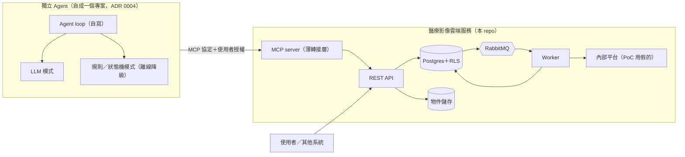
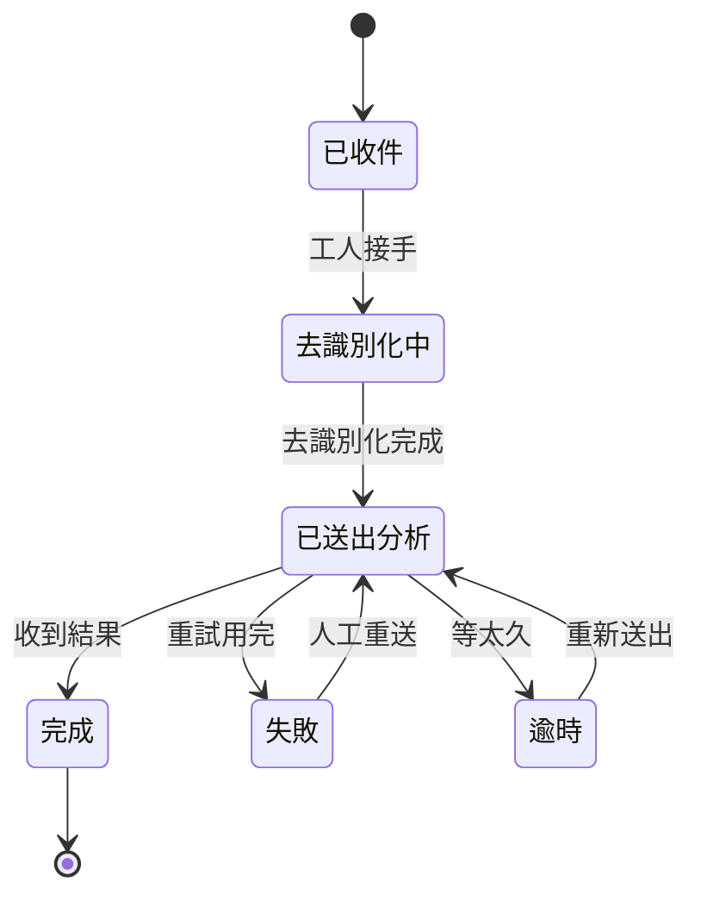
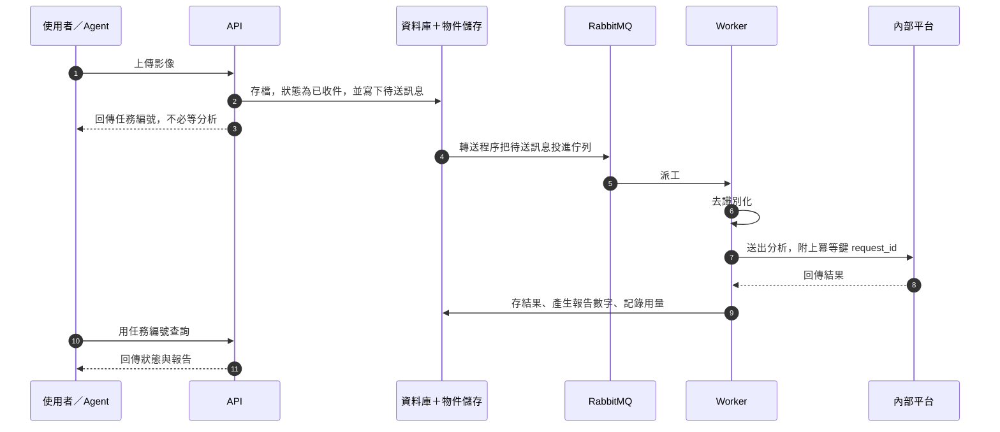

# 架構與流程

本文件描述 PoC 的目標架構。M0 只實作其中的骨架（見 README 的里程碑），其餘為設計。決策與取捨見 [docs/adr/](adr/)。

## 元件

- **事實來源是 Postgres**：案件狀態、待送訊息（outbox）、重試記帳、用量事件都在資料庫（ADR 0002）。
- **MCP server 沒有資料庫權限**，只呼叫公開的 REST API（ADR 0004）。
- 內部平台（身分、推論、計費）在 PoC 中由可注入故障的假服務取代，只存在於測試與開發環境。

## 案件狀態

狀態轉移以條件式 `UPDATE ... WHERE status = ...` 完成，避免更新被覆蓋；重複的轉移請求不會產生第二次副作用。

## 一張影像的流程

## 可靠性原則

- 訊息 at-least-once，消費端冪等；不宣稱 exactly-once。
- 對外部平台：逐層逾時（下游期限比上游短）、有限次數退避重試加抖動、斷路器、並發上限；收件不依賴平台。
- 非同步工作有逾時掃描器（`FOR UPDATE SKIP LOCKED`），重試用完進入 DLQ 並可重播。
- 租戶隔離：應用層授權為第一道，Postgres RLS（`FORCE ROW LEVEL SECURITY`、非 owner 角色）為最後防線。
